# Class diagram

Status: draft for user approval; version 0.1.1.

> [!NOTE]
> `Edit`, `EditTXT` and `EditDOC` are implemented in `src/edit.c` and
> `src/edit_subclass/`. `EditPDF`, `EditUML` and `EditCode` are still
> `<<planned>>`: `include/edit_subclass/editPDF.h` and `editUML.h` exist but
> are empty. `main.c` creates editors from the per-subject menu
> (`SubjectPanel`, `MenuEditKind`, `EditKind`). `Menu` and `MenuEditKind` are
> implemented in `src/menu.c` and `src/msc/`.

StudyStudio is written in C, so it has no real classes. This diagram models the
object-oriented patterns the code already uses: `struct Subject` with methods as
function pointers (assigned in `new_subject()`, called as `self->method(self, ...)`),
`new_subject()` / `close_subject()` as constructor and destructor, and
`SubjectLogFunc` as an abstract interface that decouples `subject.c` from GTK.
`Edit` and `Menu` apply the same pattern with inheritance: each subclass embeds
the base as its first member and assigns the abstract function pointers.

```mermaid
classDiagram
    direction TB

    class MainGUI {
        <<module>>
        -on_add_clicked(GtkButton* button, gpointer user_data)$ void
        -on_kind_chosen(const EditKind* kind, gpointer user_data)$ void
        -on_open_doc_finish(GObject* source, GAsyncResult* res, gpointer user_data)$ void
        -on_save_doc_clicked(GtkButton* button, gpointer user_data)$ void
        -on_close_doc_clicked(GtkButton* button, gpointer user_data)$ void
        -subject_panel_free(gpointer data)$ void
        -panel_button(const char* label, GCallback cb, SubjectPanel* panel)$ GtkWidget*
        -app_status(AppState* state, const char* msg)$ void
        -on_load_clicked(GtkButton* button, gpointer user_data)$ void
        -on_load_dialog_finish(GObject* source, GAsyncResult* res, gpointer user_data)$ void
        -on_subject_log(const char* msg, void* user_data)$ void
        -activate(GtkApplication* app, gpointer user_data)$ void
        +main(int argc, char* argv[])$ int
    }

    class AppState {
        <<struct>>
        +GtkWidget* destiny_content
        +GtkWidget* window
        +GtkWidget* footer_label
        +int counter
    }

    class EditKind {
        <<struct>>
        +const char* label
        +const char* filter_name
        +const char* const* suffixes
        +create() Edit*
        +available() bool
    }

    class SubjectPanel {
        <<struct>>
        +AppState* state
        +GtkWidget* menu_button
        +GtkWidget* revealer
        +GtkWidget* editor_box
        +const EditKind* kind
        +Edit* edit
    }

    class SubjectLogFunc {
        <<interface>>
        +log(const char* msg, void* user_data) void
    }

    class SubjectLogger {
        <<module>>
        -SubjectLogFunc g_log_fn$
        -void* g_log_data$
        +subject_set_logger(SubjectLogFunc fn, void* user_data)$ void
        -subject_log(const char* fmt, ...)$ void
    }

    class Subject {
        <<struct>>
        +int val
        +pid_t pid [Linux]
        +HANDLE proc_handle [Win32]
        +new_subject(int value) Subject*$
        +fatal(const char* msg) void
        +read_subject() void
        +wait_pid_os_opt(int* status) int
        +load_subject(const char* path, uint8_t** out_buf, size_t* out_size) int
        +save_subject(char** msg, const char** dir, const char** outpath) void
        +close_subject() void
        +is_dot_or_dotdot(const char* name) int [Win32]
        +feed_bytes(lzma_stream* strm, uint8_t* outbuf, size_t out_buf_size, FILE* outfile, const uint8_t* data, size_t len) int [Win32]
        +walk_directory(const char* base_path, const char* rel_prefix, WalkContext* ctx) int [Win32]
    }

    class WalkContext {
        <<struct Win32>>
        +FILE* outFile
        +lzma_stream* strm
    }

    class Edit {
        <<abstract>>
        +char* path
        +bool modified
        +GtkWidget* widget
        +open(const char* path)* int
        +save()* int
        +render(GtkWidget* container)* void
        #finalize()* void
        +close() void
        +is_modified() bool
        #mark_modified(bool modified) void
        #set_path(const char* path) void
        #set_widget(GtkWidget* widget) void
        #edit_init(Edit* self)$ void
        +new_edit_for_path(const char* path)$ Edit*
    }

    class EditTXT {
        -Edit base
        -GtkTextBuffer* buffer
        -gulong modified_id
        +const char* edit_txt_suffixes[]$
        +new_edit_txt()$ Edit*
        +open(const char* path) int
        +save() int
        +render(GtkWidget* container) void
        #finalize() void
    }

    class EditDOC {
        -Edit base
        -LibreOfficeKitDocument* lok
        -long width_twips
        -long height_twips
        -GtkWidget* area
        -GtkAdjustment* vadj
        -LibreOfficeKit* s_office$
        +const char* edit_doc_suffixes[]$
        +new_edit_doc()$ Edit*
        +edit_doc_available()$ bool
        +open(const char* path) int
        +save() int
        +render(GtkWidget* container) void
        #finalize() void
    }

    class Menu {
        <<abstract>>
        +GtkWidget* popover
        +GtkWidget* list
        #activate(gpointer item_data)* void
        #finalize()* void
        #add_item(const char* label, bool sensitive, gpointer item_data) GtkWidget*
        +popdown() void
        #menu_init(Menu* self)$ void
    }

    class MenuEditKind {
        -Menu base
        -MenuEditKindChosen on_chosen
        -gpointer user_data
        +new_menu_edit_kind(MenuEditKindChosen on_chosen, gpointer user_data)$ Menu*
        #activate(gpointer item_data) void
    }

    class LibreOfficeKit {
        <<external>>
        +documentLoad(const char* url) LibreOfficeKitDocument*
        +getError() char*
        +freeError(char* err) void
    }

    class LibreOfficeKitDocument {
        <<external>>
        +initializeForRendering(const char* args) void
        +getDocumentSize(long* w, long* h) void
        +paintTile(unsigned char* buf, int cw, int ch, int x, int y, int w, int h) void
        +saveAs(const char* url, const char* fmt, const char* opts) int
        +destroy() void
    }

    class EditPDF {
        <<planned>>
        +open(const char* path) int
        +save() int
        +render(GtkWidget* container) void
    }

    class EditUML {
        <<planned>>
        +open(const char* path) int
        +save() int
        +render(GtkWidget* container) void
    }

    class EditCode {
        <<planned>>
        +open(const char* path) int
        +save() int
        +render(GtkWidget* container) void
    }

    MainGUI ..> AppState : creates in activate()
    MainGUI ..> Subject : new_subject() / load_subject()
    MainGUI ..|> SubjectLogFunc : on_subject_log
    MainGUI ..> SubjectPanel : creates in on_add_clicked()
    MainGUI ..> MenuEditKind : new_menu_edit_kind() in on_add_clicked()
    Menu <|-- MenuEditKind
    MenuEditKind ..> EditKind : one entry per edit_kinds[] row
    MenuEditKind ..> MainGUI : on_chosen = on_kind_chosen
    SubjectPanel --> AppState : state
    SubjectPanel --> EditKind : kind
    SubjectPanel o--> Edit : edit (0..1)
    EditKind ..> EditTXT : new_edit_txt / edit_txt_suffixes
    EditKind ..> EditDOC : new_edit_doc / edit_doc_suffixes
    SubjectLogger o--> SubjectLogFunc : g_log_fn
    Subject ..> SubjectLogger : subject_log()
    Subject ..> WalkContext : walk_directory()
    Edit <|-- EditTXT
    Edit <|-- EditDOC
    Edit <|-- EditPDF
    Edit <|-- EditUML
    Edit <|-- EditCode
    Edit ..> EditTXT : new_edit_for_path() .txt .md
    Edit ..> EditDOC : new_edit_for_path() office formats
    EditDOC o--> LibreOfficeKitDocument : lok
    EditDOC ..> LibreOfficeKit : s_office (lok_init once)
    LibreOfficeKit ..> LibreOfficeKitDocument : documentLoad()

    note for Subject "Methods are function pointers assigned in new_subject()\nand called as self->method(self, ...)"
    note for Edit "Abstract methods are NULL in edit_init().\nEach subclass embeds Edit as its first member\nand assigns its own open/save/render/finalize.\nrender stores its widget with set_widget (weak pointer)."
    note for Menu "The Menu is freed with its popover\n(g_object_set_data_full), never by the caller."
    note for EditDOC "All LibreOfficeKit code lives in editDOC.c.\ns_office is a process-wide singleton\nand is never destroyed."
```



## Reading the diagram

- `<<module>>` marks a source file that groups `static` functions and globals
  (`src/main.c`, `src/subject.c`) rather than a struct.
- `<<planned>>` marks a class that is not implemented yet (see the note at the
  top).
- `<<external>>` marks a C API provided by another project. `LibreOfficeKit`
  and `LibreOfficeKitDocument` are LibreOffice's structs; their methods are
  reached through `pClass` (`office->pClass->documentLoad(office, ...)`). Only
  the methods StudyStudio calls are listed.
- `[Win32]` / `[Linux]` members only exist under the matching `#ifdef _WIN32`
  branch of `include/subject.h`.
- `$` (underlined when rendered) marks `static` functions and globals.
- `*` after the parentheses (italic when rendered) marks abstract methods: in C
  they are function pointers that the base initializer leaves `NULL` and each
  subclass must assign.
- `#` marks protected members: meant to be used by the `Edit` subclasses, not by
  the rest of the application.
- `-` marks private members: fields of a subclass struct that only its own
  `.c` file touches, and `static` globals such as `s_office`.
- Pointer types are written as in C (`GtkWidget*`, `uint8_t**`).
- Private helpers in `src/subject.c` that are not exposed through `Subject`
  (for example `_unpack_tar_buffer`, `_derive_extract_dir`) are omitted.

## Relationships

| From | To | Meaning |
| --- | --- | --- |
| `MainGUI` | `AppState` | `activate()` allocates the state and passes it as `user_data` to the callbacks. |
| `MainGUI` | `SubjectPanel` | `on_add_clicked()` creates one panel per subject and ties it to the subject box with `g_object_set_data_full`; the panel callbacks receive it as `user_data`. |
| `MainGUI` | `MenuEditKind` | `on_add_clicked()` creates one menu per subject with `new_menu_edit_kind(on_kind_chosen, panel)` and gives its `popover` to the `GtkMenuButton`. |
| `MenuEditKind` | `Menu` | Inheritance: embeds `Menu` as its first member, calls `menu_init()`, reuses `add_item`/`popdown` and implements `activate`. |
| `MenuEditKind` | `EditKind` | Adds one entry per `edit_kinds[]` row (insensitive when `suffixes == NULL`) and passes the chosen row to `on_chosen`. |
| `SubjectPanel` | `Edit` | Holds the open editor (or `NULL`); `subject_panel_free()` closes it. |
| `EditKind` | `EditTXT`, `EditDOC` | Each `edit_kinds[]` row points to a subclass constructor and its exported suffix list; PDF/UML rows are placeholders (`suffixes == NULL`). |
| `MainGUI` | `Subject` | `on_load_dialog_finish()` creates a `Subject` and calls `load_subject()`. |
| `MainGUI` | `SubjectLogFunc` | `on_subject_log()` is the concrete implementation that writes to the footer label. |
| `SubjectLogger` | `SubjectLogFunc` | Stores the registered callback in `g_log_fn` via `subject_set_logger()`. |
| `Subject` | `SubjectLogger` | Reports status and errors through `subject_log()`. |
| `Subject` | `WalkContext` | Windows `walk_directory()` uses it to carry the output file and LZMA stream. |
| `EditTXT`, `EditDOC` | `Edit` | Inheritance: each subclass embeds `Edit` as its first member, calls `edit_init()`, reuses the common operations (`close`, `is_modified`, `mark_modified`, `set_path`) and implements the abstract ones (`open`, `save`, `render`, `finalize`). |
| `Edit` | `EditTXT`, `EditDOC` | Factory: `new_edit_for_path()` picks the subclass by searching `edit_txt_suffixes` / `edit_doc_suffixes` (the latter only if `edit_doc_available()`), then calls `open()`. |
| `EditDOC` | `LibreOfficeKitDocument` | Aggregation: owns the loaded document (`lok`) and calls `destroy()` on it in `finalize`. |
| `EditDOC` | `LibreOfficeKit` | Uses the process-wide `s_office` created once by `lok_init()`; it is shared by every `EditDOC` and never destroyed. |
| `EditPDF`, `EditUML`, `EditCode` | `Edit` | **Planned, not implemented.** Same inheritance contract as `EditTXT`/`EditDOC`. |

## `Edit` hierarchy

`Edit` (`include/edit.h`, `src/edit.c`) is the abstract base for the editors.
It holds the state and operations shared by every editor, while each subclass
supplies the behavior that depends on the file type. In C this follows the
same pattern as `Subject`:

```c
typedef struct Edit Edit;
struct Edit {
    char *path;
    bool modified;
    GtkWidget *widget;

    /* abstract: assigned by each subclass */
    int  (*open)(Edit *self, const char *path);
    int  (*save)(Edit *self);
    void (*render)(Edit *self, GtkWidget *container);
    void (*finalize)(Edit *self);

    /* common: implemented once in edit.c */
    void (*close)(Edit *self);
    bool (*is_modified)(Edit *self);
    void (*mark_modified)(Edit *self, bool modified);
    void (*set_path)(Edit *self, const char *path);
    void (*set_widget)(Edit *self, GtkWidget *widget);   /* weak pointer */
};

typedef struct {
    Edit base;                    /* must be the first member */
    LibreOfficeKitDocument *lok;
    /* ... */
} EditDOC;
```

Because `base` is the first member, an `EditDOC *` can be safely cast to
`Edit *`, so the rest of the application can work with any editor through the
`Edit` interface (Liskov substitution). `close()` is the shared destructor: it
drops the weak pointer on `widget`, removes the widget from its parent box,
calls the subclass `finalize()` and then frees `path` and the object.

| Class | Files | Formats | Engine |
| --- | --- | --- | --- |
| `EditTXT` | `editTXT.h`, `editTXT.c` | `.txt`, `.md` | `GtkTextView` + `GtkTextBuffer` |
| `EditDOC` | `editDOC.h`, `editDOC.c` | `.docx`, `.doc`, `.odt`, `.rtf`, `.xlsx`, `.xls`, `.ods`, `.pptx`, `.ppt`, `.odp` | LibreOfficeKit (installed LibreOffice) |

See [editTXT.c](editTXT.c.md) and [editDOC.c](editDOC.c.md) for details.

## `Menu` hierarchy

`Menu` (`include/menu.h`, `src/menu.c`) is the abstract base for drop-down
menus: it owns a `GtkPopover` with a vertical list of frameless buttons.
Subclasses live in `include/msc/` and `src/msc/` (menu subclasses) and only
decide which entries to add and what `activate` does. See
[menu.c](menu.c.md) for details.

### Subject menu (`MenuEditKind`)

Pressing a subject button (`GtkMenuButton`) opens a `MenuEditKind` popover
with one entry per `edit_kinds[]` row. Choosing a kind opens a file dialog filtered by that kind's
suffixes; the chosen file is opened with the kind's constructor and rendered
in the subject's `GtkRevealer`. Text and office documents are available;
PDF and UML are shown greyed out until `EditPDF` / `EditUML` exist.

### Diagram review (2026-10-12)

Differences found between the previous draft and the code, fixed above:

- `Edit` was marked as not implemented; it is.
- `Edit` was missing `widget`, the abstract `finalize` and the common
  `set_path`.
- `mark_modified` takes `bool modified`; `edit_init` takes `Edit *self`, not a
  path, and is a free function (`$`), not a method.
- The factory `new_edit_for_path()` was missing.
- The planned `EditDocs` became `EditTXT` (plain text) and `EditDOC`
  (LibreOfficeKit); `EditPDF`, `EditUML` and `EditCode` remain planned.
